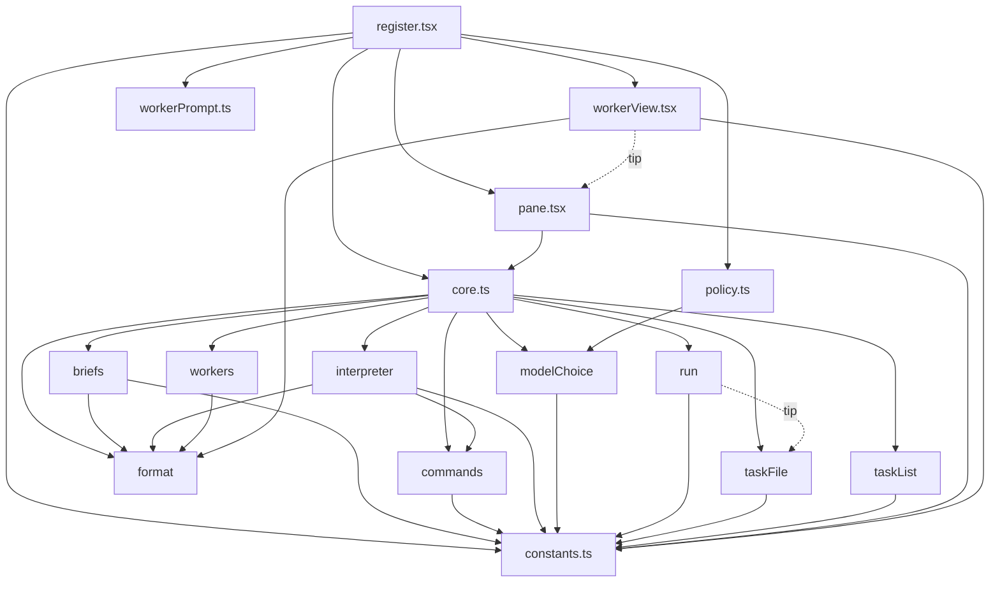

# Arquitetura

## Datas

- Criado em: 2026-11-03
- Última atualização: 2026-11-03

## Visão geral

O plugin é um "mod" do engine do Claude Code escrito em TypeScript. Não há `package.json`: o engine carrega o módulo declarado em [hooks/hooks.json](../../hooks/hooks.json) (`{ "modules": ["./register.tsx"] }`) e executa os testes com o seu próprio runner (ver [07-testes-e-validacao.md](07-testes-e-validacao.md)). O manifesto [.claude-plugin/plugin.json](../../.claude-plugin/plugin.json) declara nome, versão, metadados e `"types": "./types/index.d.ts"`; não contém campo de hooks. Como o engine encontra `hooks/hooks.json` não foi confirmado no código (o README do plugin apenas afirma que o arquivo "loads ./register.tsx").

O desenho separa dois lados:

- **Lado puro**: reducers e helpers sem acesso ao engine (`$`). Ficam nos módulos reexportados por [hooks/core.ts](../../hooks/core.ts).
- **Lado de efeitos**: [hooks/register.tsx](../../hooks/register.tsx) (915 linhas), único módulo que fala com o engine (`$.agent`, `$.store`, `$.fs`, `$.ui`, `$.clock`, `$.tool`, `$.session`, `$.model`, `$.process`) e que lê e escreve os átomos de estado.

Os painéis ([hooks/pane.tsx](../../hooks/pane.tsx), [hooks/workerView.tsx](../../hooks/workerView.tsx)) são funções puras que recebem dados e ações e devolvem uma árvore de elementos.

## Responsabilidade de cada módulo

| Módulo | Linhas | Responsabilidade |
|--------|--------|------------------|
| `hooks/register.tsx` | 915 | Registro dos hooks, comandos, spawn, fila, run, guarda do worker, polling e desenho |
| `hooks/core.ts` | 10 | Reexporta os módulos puros (`export *`) |
| `hooks/commands.ts` | 107 | Tabela `SUBCOMMANDS`, `parseCommand`, texto `HELP` |
| `hooks/interpreter.ts` | 49 | Prompt do interpretador de pedidos em texto livre e `parseInterpretation` |
| `hooks/workers.ts` | 164 | Reducers do vetor de workers (spawn, roster, mensagem, idle, done, rename, prune), fila |
| `hooks/run.ts` | 38 | Reducers do `RunState` (unidades em execução e concluídas) |
| `hooks/taskFile.ts` | 87 | Parser do task plan, `setMark`, `readyUnits` |
| `hooks/taskList.ts` | 92 | Reconstrução da lista de tarefas do worker a partir das chamadas de ferramenta |
| `hooks/briefs.ts` | 54 | Texto do primeiro prompt do worker e detecção de `DONE`/`BLOCKED` |
| `hooks/modelChoice.ts` | 36 | Resolução de modelo e mesclagem de `modelTiers` |
| `hooks/policy.ts` | 104 | Parse da política, identidade do teammate, bloqueio de MCP e de comandos |
| `hooks/workerPrompt.ts` | 5 | Decide se um attachment do prompt deve ser escondido do worker |
| `hooks/format.ts` | 52 | `truncate`, `pushLog`, `statusGlyph`, `elapsed`, `fit` |
| `hooks/constants.ts` | 161 | Nomes, limites, expressões regulares, textos e ferramentas |
| `hooks/pane.tsx` | 123 | Árvore do painel Fleet (abas workers e tasks) |
| `hooks/workerView.tsx` | 119 | Banda de tarefas do worker e linhas escondidas |
| `types/index.d.ts` | 98 | Tipos de domínio e augmentação do módulo `claude-code` |

Observação: `core.ts` não reexporta `policy.ts`, `workerPrompt.ts`, `pane.tsx` nem `workerView.tsx`; `register.tsx` importa esses quatro direto. Constantes de `briefs.ts` (`LEAD_NAME`, `DONE_PREFIX`, `BLOCKED_PREFIX`, caminhos de instruções) e de `workers.ts` (`STALE_MS`, `DEFAULT_MAX_WORKERS`, `IDLE_NOTIFICATION`) vivem nos próprios módulos, não em `constants.ts`.

## Dependências entre módulos

Não há dependência circular nos imports verificados. `pane.tsx` importa de `core.ts`, enquanto `workerView.tsx` importa apenas o tipo `PaneParts` de `pane.tsx`.

## Superfícies que o plugin registra no engine

| Superfície | Onde | Papel |
|------------|------|-------|
| Comando `/fleet` | `register.tsx:178` (`$.command.register`) e `:198` (`command.run`) | Entrada do usuário |
| Ferramenta `mcp__fleet__command` | `register.tsx:423` (`armLead`), servida em `:262` | Entrada do modelo líder |
| Ferramenta `mcp__fleet__tasks` | `register.tsx:554` (`armWorker`), servida em `:257` | Lista de tarefas do worker |
| Painel `fleet` | `register.tsx:283`, desenhado por `renderPane` (`:903`) | Status do líder |
| Banda do worker | `register.tsx:288` (`AbovePrompt`) | Tela do worker |

O tipo das duas ferramentas é declarado em [types/index.d.ts](../../types/index.d.ts):73-97 (`BuiltinToolInputs`, `BuiltinToolResults`, `PluginState`).

## Papéis de sessão

A mesma `register` roda em toda sessão e decide o papel em `session.start` (`register.tsx:171`):

- **Líder** (padrão): registra a ferramenta `command` (`armLead`).
- **Worker**: a guarda `workerPolicy` resolve uma política não nula; registra a ferramenta `tasks`, inicia o spinner e o polling de background (`armWorker`).

Ver [02-ciclo-de-vida.md](02-ciclo-de-vida.md) para a resolução do papel.

## Change History

- Created: 2026-11-03
